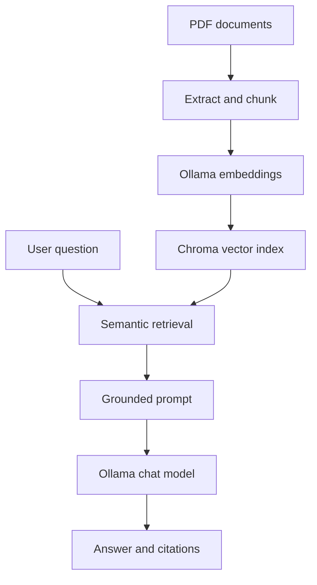

# Local PDF RAG

> A private, local-first assistant that turns PDF documents into grounded, cited answers.


Local PDF RAG is an end-to-end retrieval-augmented generation system built for
verifiability and privacy. It extracts text from PDFs, creates deterministic overlapping
chunks, generates embeddings locally with Ollama, retrieves relevant passages from Chroma,
and streams an answer with page-level citations.

The repository intentionally contains **no PDFs, model weights, or generated vector data**.
Your documents stay on your machine and are excluded from version control.

## Highlights

- **Grounded answers** — the model is instructed to use only retrieved document context.
- **Verifiable sources** — every answer is paired with ranked excerpts, filenames, pages,
  and relevance scores.
- **Local-first privacy** — inference, embeddings, documents, and vectors remain local.
- **Incremental ingestion** — SHA-256 fingerprints skip unchanged PDFs; changed documents
  are re-indexed without duplicating stale chunks.
- **Defensive prompting** — document text is treated as untrusted data to reduce prompt-
  injection risk.
- **Streaming chat UI** — polished Streamlit interface with uploads, runtime status, source
  inspection, retrieval controls, and conversation history.
- **Evaluation built in** — measure retrieval quality with Hit@K and mean reciprocal rank.
- **Production-minded delivery** — typed modules, tests, linting, CI, environment-based
  configuration, Docker, health checks, and non-root containers.

## Architecture



The application avoids a large orchestration framework on purpose. The RAG flow stays
explicit, inspectable, and easy to test: adapters handle Ollama and Chroma, while chunking,
prompting, retrieval policy, and evaluation remain independent Python modules. See
[the architecture notes](docs/architecture.md) for the design trade-offs.

## Quick start

### Prerequisites

- Python 3.11 or newer
- [Ollama](https://ollama.com/) running locally
- Enough memory for the selected chat model

### 1. Install

After cloning or downloading this repository:

```bash
cd local-pdf-rag
python -m venv .venv
source .venv/bin/activate
python -m pip install --upgrade pip
python -m pip install -e .
```

On Windows, activate the environment with `.venv\Scripts\activate`.

### 2. Pull the local models

```bash
ollama pull embeddinggemma
ollama pull gemma3:4b
```

Both model names are configurable. Changing the embedding model requires rebuilding the
vector index because vectors from different embedding spaces are not compatible.

### 3. Run the interface

```bash
streamlit run app.py
```

Open `http://localhost:8501`, upload one or more PDFs, select **Index documents**, and ask a
question. Scanned image-only PDFs need OCR before ingestion.

## Command-line workflow

Place PDFs in `data/pdfs/` and run:

```bash
local-pdf-rag ingest
local-pdf-rag ask "What are the document's main conclusions?"
local-pdf-rag status
```

Explicit paths and retrieval settings are supported as well:

```bash
local-pdf-rag ingest ./notes.pdf ./report.pdf
local-pdf-rag ask "Which risks are mentioned?" --top-k 7 --min-relevance 0.25
```

## Docker

The Compose setup starts Ollama, pulls both models, builds the application, and persists
documents, vectors, and model weights in local volumes:

```bash
docker compose up --build
```

The UI is available at `http://localhost:8501`. GPU acceleration depends on the Docker and
Ollama configuration of the host platform; the default setup also works on CPU.

## Retrieval evaluation

Copy `evaluation/questions.example.jsonl`, replace the placeholders with questions whose
correct source locations you know, then run:

```bash
local-pdf-rag evaluate evaluation/questions.jsonl --top-k 5
```

Each JSONL row has this schema:

```json
{"question": "What limitation is reported?", "expected_source": "paper.pdf", "expected_page": 7}
```

`expected_page` is optional. The command reports **Hit@K** and **MRR@K**, making retrieval
changes measurable instead of relying only on subjective answer quality.

## Configuration

Copy `.env.example` to `.env` or export the variables in your shell. Streamlit and the CLI
read the same settings.

| Variable | Default | Purpose |
| --- | --- | --- |
| `OLLAMA_HOST` | `http://localhost:11434` | Ollama API endpoint |
| `RAG_CHAT_MODEL` | `gemma3:4b` | Generative chat model |
| `RAG_EMBEDDING_MODEL` | `embeddinggemma` | Query and document embedding model |
| `RAG_CHUNK_SIZE` | `900` | Maximum chunk length in characters |
| `RAG_CHUNK_OVERLAP` | `150` | Context overlap between adjacent chunks |
| `RAG_TOP_K` | `5` | Maximum retrieved excerpts |
| `RAG_MIN_RELEVANCE` | `0.20` | Minimum cosine-based relevance score |
| `RAG_MAX_FILE_SIZE_MB` | `50` | Per-file ingestion limit |
| `RAG_PDF_DIR` | `data/pdfs` | Local document directory |
| `RAG_CHROMA_PATH` | `chroma_db` | Persistent Chroma directory |

## Quality checks

```bash
python -m pip install -e ".[dev]"
ruff check .
ruff format --check .
pytest --cov=local_pdf_rag --cov-report=term-missing
```

The same checks run on every pull request through GitHub Actions, with a minimum coverage
threshold of 90%. Tests fake the model boundary and use an isolated temporary Chroma index,
so CI never needs model downloads or access to private PDFs.

## Repository guide

- `app.py` — Streamlit presentation layer
- `src/local_pdf_rag/ingestion.py` — PDF extraction and idempotent indexing
- `src/local_pdf_rag/chunking.py` — deterministic text normalization and chunking
- `src/local_pdf_rag/vector_store.py` — Chroma persistence adapter
- `src/local_pdf_rag/ollama_client.py` — local embedding and generation adapter
- `src/local_pdf_rag/rag.py` — retrieval and answer orchestration
- `src/local_pdf_rag/prompting.py` — grounding and citation contract
- `src/local_pdf_rag/evaluation.py` — retrieval metrics
- `tests/` — isolated unit and integration-style tests with fakes

## Current boundaries

- Text extraction uses the PDF text layer; OCR is intentionally not hidden behind a silent
  fallback.
- Citations identify retrieved evidence, but an LLM can still format them incorrectly. The
  source panel remains the verification layer.
- Chroma runs as a local embedded store. Multi-user deployments would need authentication,
  authorization, isolated indexes, and a managed persistence strategy.
- This project is an information-retrieval assistant, not a substitute for professional
  legal, medical, or financial review.

## License

Released under the [MIT License](LICENSE).

## Author

**Alexander Korolev**  
B.Sc. Student — Artificial Intelligence & Robotics  
Hochschule Furtwangen University (HFU)