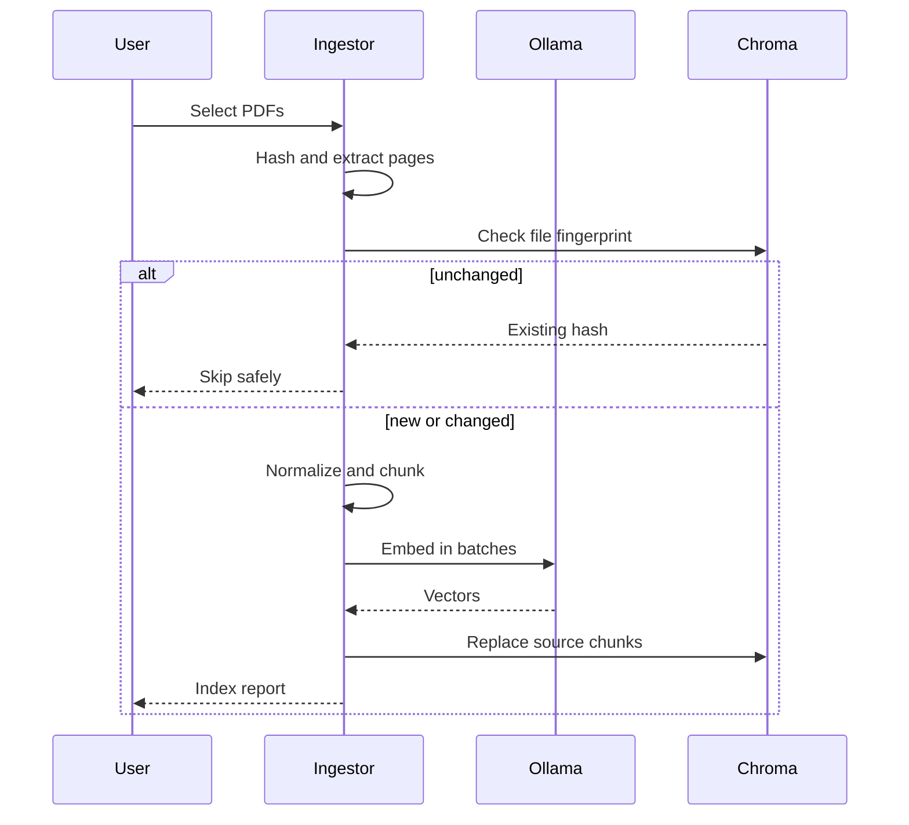

# Architecture and engineering decisions

## Design goals

The system optimizes for four properties: local data ownership, inspectable retrieval,
repeatable indexing, and small replaceable components. The Streamlit UI and CLI are thin
clients of the same application services, so behavior does not diverge between interfaces.

## Ingestion lifecycle

Chunk identifiers are derived from the file hash, page, chunk position, and content. This
makes indexing deterministic and prevents accidental duplicates. Embeddings are completed
before existing source chunks are replaced, so most upstream failures leave the prior index
untouched.

## Query lifecycle

1. Validate and embed the question with the same model used for documents.
2. Query a cosine-distance Chroma collection and convert distance into a bounded relevance
   score.
3. Apply the configured relevance threshold and remove duplicate chunk identifiers.
4. Build a delimited prompt with numbered, escaped source excerpts.
5. Stream the local model response and display the exact evidence independently of the
   model-generated citation text.

An index records its embedding-model name. Starting the application with a different model
fails with an actionable message instead of silently comparing incompatible vectors.

## Trust boundaries

| Boundary | Control |
| --- | --- |
| Uploaded filename | Directory components and unsafe characters are removed |
| Uploaded content | PDF extension, readable file, and size limit are validated |
| Document prompt injection | Source text is delimited, escaped, and explicitly treated as data |
| Unsupported scanned PDF | Reported clearly; no fabricated empty index |
| Private artifacts | PDFs, vectors, secrets, and local environments are Git-ignored |
| Container permissions | UI runs as an unprivileged user |
| Dependency outage | Ollama health is visible before indexing or querying |

The local Streamlit server has no authentication and is intended for a trusted workstation.
Exposing it on a shared network changes the threat model and requires an authenticated
reverse proxy plus per-user document isolation.

## Deliberate trade-offs

### Explicit orchestration instead of a RAG framework

The pipeline uses the Ollama and Chroma clients directly. For this scope, the result is less
dependency churn, clearer failure behavior, and unit-testable domain logic. A framework
would become valuable if the project added multiple retrievers, tool routing, agents, or
provider abstraction.

### Character-aware chunks instead of token-aware chunks

Character boundaries are deterministic across model tokenizers and need no extra runtime
model. Natural separators are preferred and adjacent chunks overlap. A production corpus
with strict context budgets should replace this with tokenizer-aware segmentation and
measure the change through the included evaluation harness.

### Embedded Chroma instead of a service

Embedded persistence makes the application genuinely one-machine and private. It is not
designed for concurrent multi-user writes. A deployed system should move this adapter to a
managed or server-based vector store without changing the domain services.

## Extension points

- Add OCR as a distinct extraction strategy with page-level confidence reporting.
- Add hybrid retrieval (BM25 plus dense vectors) and a cross-encoder reranker.
- Validate generated citation markers against the retrieved source set.
- Add observability for latency, token counts, retrieval scores, and ingestion throughput.
- Add answer-level evaluation for faithfulness and citation correctness.
